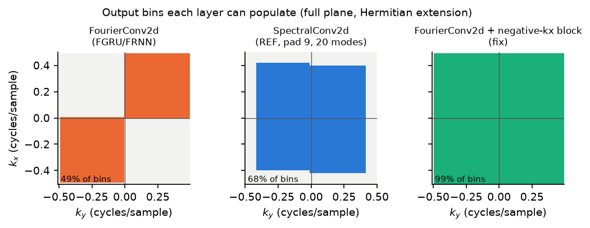
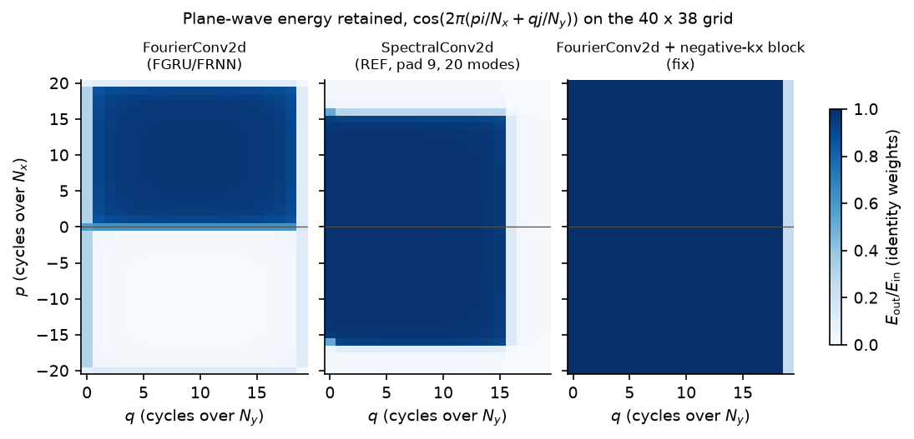
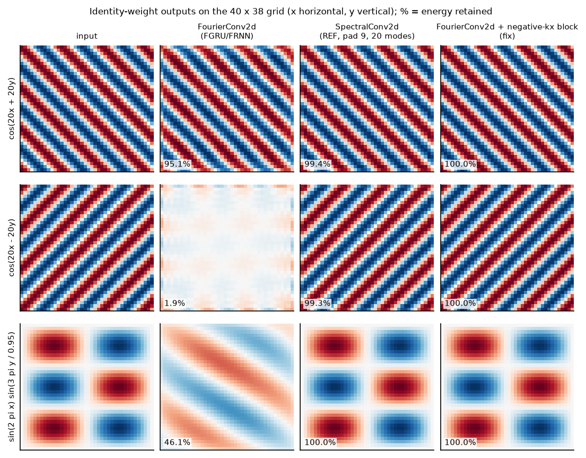
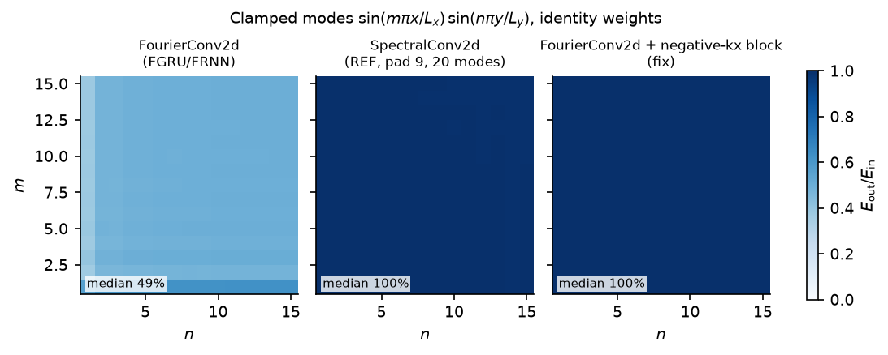
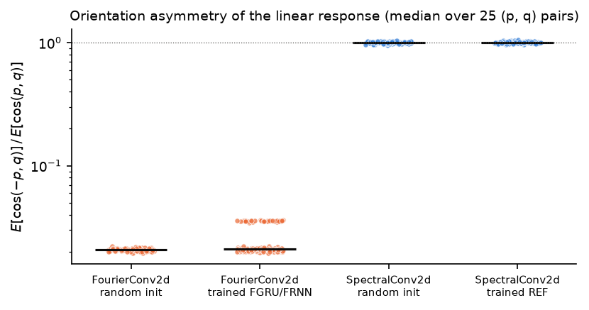
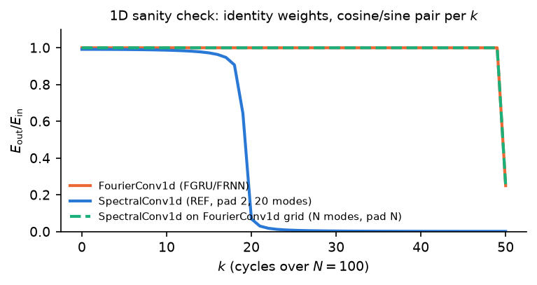
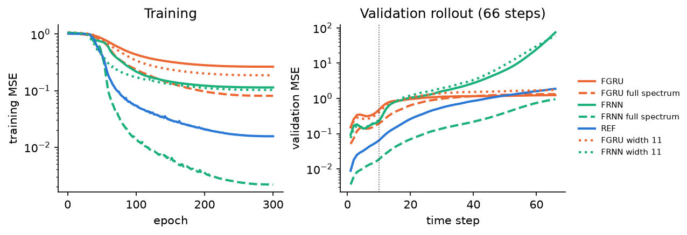

# Spectral truncation in `FourierConv2d` (FGRU/FRNN) vs `SpectralConv2d` (REF)

Investigation of [cdelavegamartin/phd-thesis#85](https://github.com/cdelavegamartin/phd-thesis/issues/85).

## Summary

- The issue is **confirmed**.
  `FourierConv2d` discards every output bin with negative $k_x$ (rows $N_x \dots 2N_x-1$ of the `rfft2` output).
  Through Hermitian symmetry, this removes the quadrant pair ($k_x<0, k_y>0$) / ($k_x>0, k_y<0$) from the full spectrum, whatever the weights.
- `FourierConv2d` is numerically identical (max. abs. difference $8.9\times10^{-8}$) to `SpectralConv2d` with `modes = (Nx, Ny)` on the same padded grid and `weights2 = 0`.
  The bug is exactly the missing `weights2` block.
- On the 40 x 38 membrane grid with identity weights, `FourierConv2d` keeps 95.1% of the energy of $\cos(20x+20y)$, 1.9% of $\cos(20x-20y)$, and 46.1% of the clamped mode $\sin(2\pi x)\sin(3\pi y/0.95)$.
  These match the numbers in the issue.
  `SpectralConv2d` keeps 99.4%, 99.3% and 100.0%.
- Clamped modes $(m, n) \in [1, 15]^2$ keep a median of 49% of their energy through `FourierConv2d`, against 99.8% through `SpectralConv2d`.
- The asymmetry holds for every weight set tested: 100 random initialisations, and all 258 trained `FourierConv2d` layers (FGRU and FRNN, 43 runs in `output/2d_wave_*`).
  The response to $\cos(-p, q)$ is 1.9–3.6% of the response to $\cos(p, q)$.
  Trained and random `SpectralConv2d` layers give 96–105%.
- The 1D layer is **not** affected.
  `FourierConv1d` passes every frequency below Nyquist unchanged (ratio $1 \pm 3\times10^{-7}$) and matches `SpectralConv1d` exactly.
- Two smaller, related effects exist in `FourierConv2d`: waves along $x$ only ($k_y=0$) keep ~30% of their energy, and both 1D and 2D layers drop the Nyquist bin of the padded grid.
- Adding a second weight block for the negative-$k_x$ rows (`FourierConv2dFullSpectrum`) restores the full spectrum.
- A reduced-scale retraining on the 2D wave equation of `train_2d_wave.py` (one seed, CPU) shows a large effect.
  With the full spectrum, FRNN validation MSE drops from 0.167 to 0.0112 (15x) within the training length and now beats REF (0.0363); FGRU drops from 0.328 to 0.133 (2.5x).
  Width-11 controls with the original layer and a similar parameter count (1.20M vs 1.31M) do not improve (FRNN 0.167, FGRU 0.276), so the gain comes from the restored quadrants, not from model size.

## Code under test

The script imports the layers from this repository unchanged (branch base `3b13cff`; the truncation is identical at `e08b4b0`, the commit cited in the issue).

| Layer | Used by | Padding | Retained output bins (`rfft*` output) |
|---|---|---|---|
| `FourierConv1d` (`dafx22_fno/modules/layers.py`) | 1D FGRU, FRNN | $N \to 2N$ | `[:N]` of $N+1$: all but Nyquist |
| `SpectralConv1d` (`dafx22_fno/modules/fno_ref.py`) | 1D REF | $N \to N+2$ | `[:20]` |
| `FourierConv2d` (`dafx22_fno/modules/layers.py`) | 2D FGRU, FRNN | $(N_x, N_y) \to (2N_x, 2N_y)$ | `[:Nx, :Ny]` of $(2N_x, N_y+1)$ |
| `SpectralConv2d` (`dafx22_fno/modules/fno_ref.py`) | 2D REF | $(N_x, N_y) \to (N_x+9, N_y+9)$ | `[:20, :20]` and `[-20:, :20]` |

`rfft2` halves only the last axis.
Its output has shape $(H, W/2+1)$: the first axis still holds both signs of $k_x$ (rows $0 \dots H/2-1$ for $k_x \ge 0$, rows $H/2 \dots H-1$ for $k_x<0$), and the second axis holds $k_y \ge 0$ only.
Hermitian symmetry, $X(-k_x, -k_y) = \overline{X(k_x, k_y)}$, makes the $k_y<0$ half redundant, but not the $k_x<0$ rows.
`SpectralConv2d` reads both row blocks with separate weights (`weights1`, `weights2`).
`FourierConv2d` reads only the first block.
In 1D, `rfft` output has no second axis, so the slice `[:N]` keeps every non-redundant bin.

A plane wave $\cos(k_x x + k_y y)$ with $k_x k_y > 0$ lives in quadrants I/III, which `FourierConv2d` keeps.
A wave with $k_x k_y < 0$ lives in quadrants II/IV, which it drops.
A standing (clamped) mode $\sin(k_x x)\sin(k_y y)$ is the sum of one wave of each kind, so `FourierConv2d` loses about half of it.

## Method

`compare_spectral_layers.py` runs six tests, all in float32 as in training:

1. **Exact equivalence.**
   Random `FourierConv2d` weights $W$ copied into `SpectralConv2d(modes1=Nx, modes2=Ny)` as `weights1`, with `weights2 = 0`, applied to the same $(2N_x, 2N_y)$ zero-padded input.
   Same for 1D with `SpectralConv1d(modes1=N)`.
2. **Retained bins.**
   The script intercepts the spectrum each layer passes to `torch.fft.irfft2` and plots its non-zero bins over the full $(k_x, k_y)$ plane.
3. **Plane-wave passband.**
   Identity weights ($1+0j$ in every retained bin), single channel, no bias.
   Input $\cos(2\pi(pi/N_x + qj/N_y))$ and its sine counterpart; metric $E_\mathrm{out}/E_\mathrm{in}$ on the physical grid.
4. **Issue examples and clamped modes.**
   Same identity layers on the physical grid of `train_2d_wave.py` (`linspace(0, 1, 40)` x `linspace(0, 0.95, 38)`).
5. **Orientation test.**
   For width-8 layers, the linear response `layer(u) - layer(0)` to $\cos(p, q)$ and $\cos(-p, q)$, one input channel at a time, for 25 $(p, q)$ pairs with $p, q \in \{1, 2, 3, 5, 8\}$.
   Metric: median of $E[\cos(-p,q)] / E[\cos(p,q)]$.
   Applied to 100 random initialisations and to every trained layer in `output/2d_wave_*`.
6. **1D sanity check.**
   Identity-weight passband of `FourierConv1d` and `SpectralConv1d` on the $N = 100$ string grid.

"REF" below means the spectral path of `FNO_Markov_2d.cell`: pad by 9, `SpectralConv2d(modes1=20, modes2=20)`, crop.
"Fix" means `FourierConv2dFullSpectrum` in `full_spectrum.py`: `FourierConv2d` plus a second weight block on rows `[-Nx:]`.

## Results

### Equivalence

| Check | Max. abs. difference | Output RMS |
|---|---|---|
| 2D: `FourierConv2d` vs `SpectralConv2d`, `weights2 = 0` | $8.9\times10^{-8}$ | 0.0995 |
| 2D: `FourierConv2d` vs `SpectralConv2d`, `weights2 = weights1` | 0.363 | 0.0995 |
| 1D: `FourierConv1d` vs `SpectralConv1d` (modes $N$) | $8.9\times10^{-8}$ | 0.154 |

`FourierConv2d` equals `SpectralConv2d` without its negative-$k_x$ weights.
Its 1D counterpart equals `SpectralConv1d` with nothing missing.

### Retained bins



`FourierConv2d` can populate only quadrants I and III.
REF populates a symmetric low-pass rectangle of $\pm 20$ modes (by design).
The fix populates every bin except the Nyquist column.

### Plane-wave passband



| Region (identity weights, mean $E_\mathrm{out}/E_\mathrm{in}$) | `FourierConv2d` | REF | Fix |
|---|---|---|---|
| $p>0, q>0$ | 0.868 | 0.605 | 0.961 |
| $p<0, q>0$ | **0.027** | 0.637 | 0.961 |
| $q=0$, $p\neq0$ (along $x$ only) | 0.299 | 0.773 | 1.000 |
| $p=0$, $q>0$ (along $y$ only) | 0.598 | 0.792 | 0.961 |

REF has lower means because 20 modes cut the high-frequency waves; inside its passband it keeps both orientations.
The fix's 0.961 comes from the $q = N_y/2$ column (the Nyquist bin of the padded grid), which all three layers drop.
Along $x$ only ($k_y = 0$), `irfft2` keeps only the Hermitian part of the $k_y=0$ column, so keeping one sign of $k_x$ halves the amplitude (~25% of the energy, ~30% with padding leakage).
Along $y$ only, the zero-padding window in $x$ spreads energy into $k_x<0$, which `FourierConv2d` then drops.

### Issue examples



| Input (40 x 38 grid) | `FourierConv2d` | REF | Fix |
|---|---|---|---|
| $\cos(20x+20y)$ | 95.1% | 99.4% | 100.0% |
| $\cos(20x-20y)$ | **1.9%** | 99.3% | 100.0% |
| $\sin(2\pi x)\sin(3\pi y/0.95)$ | **46.1%** | 100.0% | 100.0% |

`FourierConv2d` turns the standing mode into a travelling diagonal wave: it keeps the $k_xk_y>0$ component and drops the other.

### Clamped membrane modes



| $(m, n) \in [1, 15]^2$ | `FourierConv2d` | REF | Fix |
|---|---|---|---|
| median | **49.4%** | 99.8% | 100.0% |
| range | 36.9–62.6% | 99.3–100.0% | 99.95–100.0% |

### Orientation asymmetry with random and trained weights



| Layers | $n$ | Median $E[\cos(-p,q)]/E[\cos(p,q)]$ | Range |
|---|---|---|---|
| `FourierConv2d`, random init | 100 | 0.021 | 0.020–0.022 |
| `FourierConv2d`, trained FGRU/FRNN | 258 | 0.021 | 0.019–0.036 |
| `SpectralConv2d`, random init | 100 | 0.997 | 0.959–1.047 |
| `SpectralConv2d`, trained REF | 111 | 1.006 | 0.960–1.052 |

Training does not, and cannot, recover the dropped quadrants: no weight multiplies those bins.
The trained layers come from the 43 runs in `output/2d_wave_*` (grids 40 x 38, 40 x 32 and 21 x 17).
The script skips the REF layers of the six 21 x 17 runs, because 20 modes exceed that padded grid and the current `SpectralConv2d` fails on it.

### 1D sanity check



`FourierConv1d` passes every $k < N/2$ with ratio $1 \pm 3\times10^{-7}$, identical to `SpectralConv1d` with $N$ modes on the same padded grid.
At $k = N/2$ it keeps 25%, because the slice `[:N]` drops the Nyquist bin of the $2N$ grid.
REF (`SpectralConv1d`, 20 modes, padding 2) is a low-pass filter by design.

## Retraining with the full spectrum

`retrain_full_spectrum.py` retrains the 2D wave models of `train_2d_wave.py` (commit `e08b4b0` set-up) at a scale that runs on a CPU.

| Setting | Original (`e08b4b0`) | Here |
|---|---|---|
| Data | 1024 examples, 33 output steps, 90/10 split | 128 training examples (first 10 of 33 steps), 32 validation examples of 66 steps |
| Grid, sample rate, solver | 40 x 38, 48 kHz, `WaveSolver2D` (FTM, 25 modes), half impulses, half random | same |
| Training | 5000 epochs, batch 400, one optimiser and joint gradient clipping for all three models | 300 epochs, batch 16, one optimiser and clipping per model |
| Optimiser | AdamW (lr $10^{-4}$, weight decay $10^{-4}$), OneCycleLR (max $10^{-3}$), log10 MSE loss | same |
| Seeds | — | one (seed 0); all models share the initialisation seed and data |

Models: FGRU and FRNN with the original `FourierConv2d`, the same models with `FourierConv2dFullSpectrum` (same initial positive-$k_x$ weights; new negative-$k_x$ block), REF, and two capacity controls: FGRU and FRNN with the original layer at width 11, whose parameter count (1.20M) is close to that of the full-spectrum models (1.31M).



The dotted vertical line marks the 10 training steps.

| Model | Parameters | Train MSE | Val. MSE, steps 1–10 | Val. MSE, steps 1–33 | Val. MSE, steps 1–66 |
|---|---|---|---|---|---|
| FGRU | 656,699 | 0.265 | 0.328 | 0.771 | 0.979 |
| FGRU full spectrum | 1,313,339 | 0.081 | **0.133** | **0.518** | **0.878** |
| FGRU width 11 | 1,203,920 | 0.187 | 0.276 | 0.846 | 1.23 |
| FRNN | 656,915 | 0.114 | 0.167 | 0.830 | 7.84 |
| FRNN full spectrum | 1,313,555 | 0.0022 | **0.0112** | **0.0633** | **0.263** |
| FRNN width 11 | 1,204,316 | 0.103 | 0.167 | 0.975 | 8.70 |
| REF | 309,003 | 0.0156 | 0.0363 | 0.241 | 0.733 |

MSE is on data normalised to unit standard deviation per channel; a zero prediction scores about 1.

- Restoring the dropped quadrants improves both recurrent models; FRNN improves by more than an order of magnitude at every horizon.
- With the full spectrum, FRNN beats REF by a factor of about 3 at every horizon; with the original layer, REF beats both FGRU and FRNN.
  This reproduces the ordering reversal of Parker et al. on the 2D wave equation and removes it once the layer is complete.
- The width-11 controls stay at the level of the width-8 models, so the extra parameters alone do not explain the improvement.
- FGRU improves less; its outputs decay towards zero after the training length (MSE ≈ 1), with or without the fix.
- FRNN without the fix diverges past the training length (MSE 7.8 at 66 steps); with the fix it stays below REF up to 66 steps.

These numbers come from one seed, a small dataset and 300 epochs; they show the direction and size of the effect, not the values a full-scale run would reach.

## Implications

- The background text (`subsec:spectral-convolution-layers`) holds in 1D only.
  In 2D, `rfft2` removes only the redundant negative half of the last axis, and `FourierConv2d` additionally removes the non-redundant negative-$k_x$ half.
- The spectral paths of the 2D FGRU and FRNN cannot represent standing modes.
  Only the pointwise paths (the `w` 1x1 convolutions in FRNN, the gating and $(1-z)h$ term in FGRU) carry the dropped quadrants, and they cannot propagate them spatially.
  The dropped content must come back through the nonlinearities, if at all.
- The reduced-scale retraining supports the issue's hypothesis that the truncation explains the reversal of Parker et al.: with the full spectrum, FRNN beats REF on the 2D wave equation, as the 1D models do on the string.
  A full-scale rerun (all data, 5000 epochs, several seeds) SHOULD confirm this before the thesis states it as a result.
- The fa2023 code has the identical `FourierConv2d` (`platefno/nn/layers.py`) on the same 40 x 38 grid and width 8, so the single-layer results above apply unchanged.
  Its simply supported boundary makes $\sin(m\pi x/L_x)\sin(n\pi y/L_y)$ the exact eigenmodes, which the FGRU/FRNN spectral path halves.
  The FGRU/FRNN results of the thesis chapter `ch:results-fno-membrane` therefore come from the truncated layer, and a plan to retrain them with the fix exists in fa2023 (`.agents-plan/full-spectrum-fourierconv2d.md`, untracked).

## Limitations

- Tests 2–6 use identity or random weights for single layers, plus trained weights for the orientation test; only the retraining evaluates full models.
- The retraining uses one seed, 128 training examples, 10-step rollouts and 300 epochs, and per-model optimisers instead of the joint optimiser and clipping of `train_2d_wave.py`.
- The passband metric uses the zero-padded, non-periodic layer, so waves not on the padded DFT grid leak energy; the values are therefore not exactly 0 or 1.
- The fix doubles the spectral parameters of `FourierConv2d`; the width-11 controls match the parameter count but also change the channel width, so they control for capacity only approximately.
- Side finding, not investigated: `WaveSolver2D` calls `trapz(xs, funX)`, which passes the grid as the integrand; `numpy.trapz` takes `(y, x)`.

## Reproduce

```bash
uv sync
uv run python analysis/spectral_truncation/compare_spectral_layers.py --runs-dir <path-to>/output
# Retraining: generate the data once, train each model in its own process, then merge.
# Each model takes 35-65 min with 3-7 threads on a 16-core CPU.
R=analysis/spectral_truncation/retrain_full_spectrum.py
ARGS="--variations 128 --validation 32 --data-cache data.pt --train-steps 10 --epochs 300 --batch-size 16"
uv run python $R $ARGS --generate-only
i=0; for m in "FGRU" "FGRU full spectrum" "FRNN" "FRNN full spectrum" "REF" "FGRU width 11" "FRNN width 11"; do
  i=$((i+1)); uv run python $R $ARGS --threads 2 --models "$m" --tag m$i &
done; wait
uv run python $R --merge m1 m2 m3 m4 m5 m6 m7
```

`compare_spectral_layers.py` writes `results.json` and `figures/fig1`–`fig6`.
`retrain_full_spectrum.py` writes `retrain_results.json` and `figures/fig7_retrain.png`.
